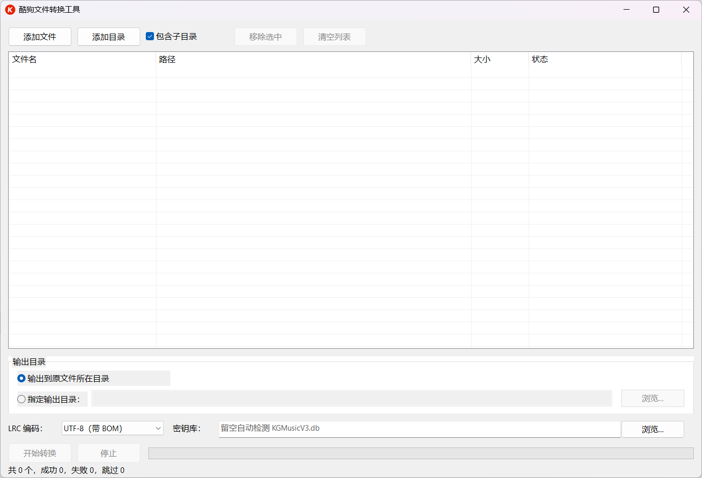

# 酷狗文件转换工具

## 软件介绍



酷狗文件转换工具是一款完全离线的 Windows 桌面小工具，用于把酷狗音乐客户端产生的私有格式转换为通用开放格式：

- 酷狗加密歌词 `.krc` → 通用 `.lrc`
- 酷狗加密音频 `.kgg` / `.kgma` / `.kgm` / `.vpr` → 原始音频（MP3 / FLAC / OGG / WAV / M4A 等）

程序同时提供图形界面和命令行两种模式。运行时不联网、不修改源文件、不生成日志，也不依赖任何第三方运行时或加密库。

### 支持的格式

| 源格式 | 输出 | 说明 |
|---|---|---|
| `.krc` | `.lrc` | 解密后转换；保留 `ti/ar/al/by/offset` 元数据，去除逐字时间标签 |
| `.kgg` | 原始音频 | 新版（加密版本 5）依赖本机酷狗密钥库；旧版本按公钥表算法处理 |
| `.kgma` | 原始音频 | 按公钥表算法处理 |
| `.kgm` | 原始音频 | 与 KGMA 同族算法 |
| `.vpr` | 原始音频 | 与 KGM / KGMA 同族算法 |

输出扩展名根据解密后的文件头确定，常见对应关系：

- `ID3` → `.mp3`
- `fLaC` → `.flac`
- `OggS` → `.ogg`
- `RIFF` → `.wav`
- `ftyp` → `.m4a`
- 其他常见音频魔数也会尽量识别（AAC、APE、WavPack、AIFF、WMA、MKA 等）

若解密成功但无法识别真实格式，默认输出 `.mp3`，并在主文件名后、扩展名前追加 `_未识别格式`。例如：

```text
歌曲名_未识别格式.mp3
```

### 运行环境

- Windows 7 及以上（32 位系统使用 x86 版本，64 位系统使用 x64 版本）
- 无需安装，直接运行
- 不依赖 MinGW 运行时、Visual C++ 运行库或任何第三方 DLL
- 仅使用 Windows 系统自带组件（kernel32、user32、comctl32、shell32、ole32、msvcrt 等）

> 构建 Win7 兼容版本时，建议使用 MSVCRT 目标的 MinGW-w64（如 MSYS2 的 `mingw64` / `mingw32`），不要使用 UCRT64 目标；UCRT 构建通常只适用于 Windows 10/11。

---

## 使用说明

### 图形界面

双击 `kugou-tool.exe`，或执行：

```bat
kugou-tool.exe --gui
```

1. 点击“添加文件”，在系统文件选择窗口中选择一个或多个受支持文件；也可以点击“添加目录”添加整个文件夹，或直接把文件/文件夹拖入窗口。
2. “包含子目录”默认勾选。添加目录或拖入文件夹时，会按该选项决定是否递归子目录。
3. 选择输出位置：
   - 默认“输出到原文件所在目录”
   - 也可选择“指定输出目录”，输入路径或点击“浏览…”选择；目录不存在时会自动逐级创建
4. 选择 LRC 编码（仅影响 `.krc` 转换）：UTF-8（带 BOM，默认）/ UTF-8（无 BOM）/ GBK。
5. 新版 `.kgg` 需要酷狗本地密钥库。密钥库一栏留空会自动探测；也可以填写 `KGMusicV3.db` 的完整路径，或填写包含该文件的酷狗安装目录。
6. 点击“开始转换”。转换在后台执行，列表状态和总进度实时更新；点击“停止”可中止当前及后续文件。
7. 任务结束（完成或停止）后会弹出一次摘要：总数 / 成功 / 失败 / 跳过。

### 命令行

```text
kugou-tool.exe [选项] <文件|目录> ...
```

不带任何参数启动图形界面；带参数进入命令行模式；`--gui` 会忽略其余参数并强制启动图形界面。

#### 参数

| 参数 | 说明 |
|---|---|
| `-o <目录>` | 指定输出目录，默认输出到源文件所在目录；目录不存在时自动创建 |
| `-r` | 递归处理目录内的子目录；默认不递归 |
| `-y` | 覆盖已存在文件，不询问 |
| `-n` | 跳过已存在文件，不询问 |
| `-e <编码>` | LRC 输出编码：`utf8` / `utf8bom` / `gbk`，默认 `utf8bom` |
| `-v` | 显示详细信息（源格式、输出路径等） |
| `--keydb <路径>` | 指定酷狗密钥库 `KGMusicV3.db`，或包含它的酷狗安装目录 |
| `--kugou-dir <目录>` | 同 `--keydb`，用于指定酷狗安装目录 |
| `--gui` | 启动图形界面，忽略其余参数 |
| `-h`, `--help` | 显示帮助并退出 |

位置参数可以混合传入文件和目录：

- 目录默认不递归，使用 `-r` 开启递归
- 目录中只收集受支持的扩展名
- 同一文件按完整路径规范化后自动去重，重复传入会被忽略
- 显式传入不支持的文件类型会报告错误

#### 示例

```bat
:: 逐个转换，输出到源文件所在目录
kugou-tool.exe a.krc b.kgg

:: 递归转换目录，输出到 D:\out
kugou-tool.exe -o D:\out -r "E:\音乐"

:: 全部覆盖，LRC 使用 GBK 编码
kugou-tool.exe -y -e gbk a.krc b.krc

:: 指定酷狗密钥库（文件或目录均可）
kugou-tool.exe --keydb "C:\Users\you\AppData\Roaming\KuGou8\KGMusicV3.db" song.kgg

:: 强制启动图形界面
kugou-tool.exe --gui
```

> 通配符 `*.krc` 是否展开取决于调用方 shell。cmd 默认不展开通配符，可改用目录参数；PowerShell、Git Bash 等会先行展开。

#### 覆盖询问

未指定 `-y` / `-n` 且目标文件已存在时：

- stdin 为可交互控制台时，逐个询问：
  - `y` = 是
  - `n` = 否
  - `a` = 全部是
  - `s` = 全部否
- stdin 不可交互（重定向、管道等）时，默认跳过该文件并输出警告

#### 退出码

| 退出码 | 含义 |
|---|---|
| `0` | 全部成功（跳过不计为失败） |
| `1` | 存在失败，或存在无效输入路径，或被停止 |
| `2` | 参数/用法错误 |

#### 控制台编码

命令行信息按当前控制台代码页输出；直接输出到控制台时使用 Windows 控制台宽字符接口，中文不会乱码。

### 密钥库说明

新版 `.kgg` 文件（加密版本 5）使用酷狗客户端本地数据库中的密钥。程序支持：

- 自动探测常见位置，例如 `%APPDATA%\KuGou8\KGMusicV3.db` 及其常见变体目录
- 通过 GUI 的“密钥库”输入框指定文件或酷狗安装目录
- 通过 CLI 的 `--keydb <路径>` / `--kugou-dir <目录>` 指定

如果找不到密钥库，该文件会明确报错：

```text
失败：需要密钥库：未找到 KGMusicV3.db（请指定密钥库文件或酷狗安装目录）
```

如果找到了数据库但其中没有该文件的密钥，会提示：

```text
失败：解密失败：密钥库中未找到该文件的密钥
```

新版 KGG 的密钥通常需要在该电脑上用酷狗播放/下载过对应歌曲后才会存在，建议在下载该文件的同一台设备上转换。

### 输出命名规则

- `.krc`：源文件主名不变，扩展名改为 `.lrc`
- 音频：源文件主名不变，扩展名按解密后文件头确定
- 无法识别音频格式：`源文件主名_未识别格式.mp3`

输出采用“临时文件写完后重命名”的方式：失败、停止或中断时不会留下未完成的正式输出，也不会覆盖源文件。

---

## 构建说明

### 环境要求

- Windows 系统
- MinGW-W64（GCC），需要同时具备：
  - x64 编译器（用于 `bin\x64`）
  - x86 编译器（用于 `bin\x86`）
  - 对应架构的 `windres.exe`（资源编译）
- 推荐使用 MSYS2：
  - x64：`C:\msys64\mingw64\bin`
  - x86：`C:\msys64\mingw32\bin`
- 若需要兼容 Windows 7，请使用 MSVCRT 目标的 `mingw64` / `mingw32` 工具链，不建议使用 UCRT64

### 构建方法

在项目根目录双击 `build.bat`，或执行：

```bat
build.bat
```

构建脚本会自动探测可用的 x64/x86 编译器，缺少某一架构时给出提示并跳过，不会中断另一架构的构建。构建完成后会暂停窗口以便查看结果。

用于自动化或脚本调用时可传入 `nopause` 跳过暂停：

```bat
build.bat nopause
```

编译选项包含：

- `-static -static-libgcc`：静态链接，产物可单独拷贝运行
- `-Wall -Wextra`：开启警告检查
- `-mwindows` + `-municode`：GUI 子系统 + Unicode 入口
- `-O2 -s`：优化并去除符号

### 构建产物

```text
bin\x64\kugou-tool.exe
bin\x86\kugou-tool.exe
```

两个文件同名，分别对应 64 位和 32 位系统，均可在没有源码和编译环境的电脑上直接运行。
